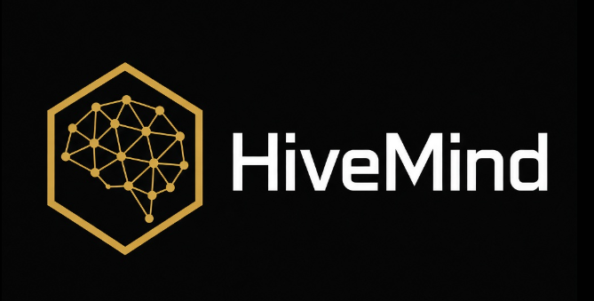
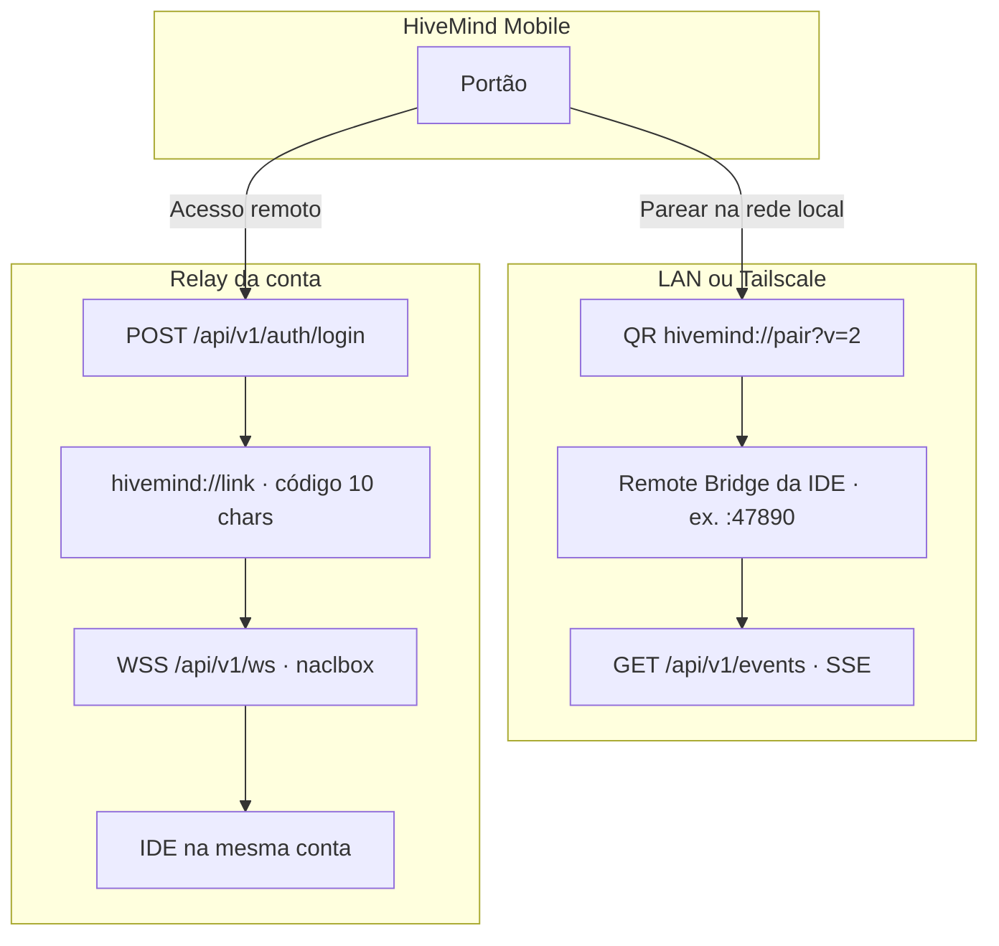

<p align="center">
  
</p>

<p align="center">
  <strong>A equipe HiveMind no bolso.</strong><br/>
  O motor continua no PC. O Android lista projetos, conversa com as lanes,<br/>
  resolve aprovações, acompanha tasks/PRs e lê o diff — na LAN ou via relay.
</p>

<p align="center">
  <a href="https://github.com/gilvan-Borges/HiveMind-App/releases/latest"></a>
  <a href="https://github.com/gilvan-Borges/HiveMind-App/actions/workflows/android-ci.yml"></a>
  
  
  
</p>

<p align="center">
  <a href="https://github.com/gilvan-Borges/HiveMind-App/releases/latest"><strong>Download APK</strong></a>
  · <a href="https://github.com/gilvan-Borges/hivemind">HiveMind (IDE + CLI + relay)</a>
  · Android 8.0+
</p>

<p align="center">
  <a href="#o-que-o-app-faz">O que faz</a> ·
  <a href="#como-chega-no-pc">Como chega no PC</a> ·
  <a href="#instala%C3%A7%C3%A3o">Instalar</a> ·
  <a href="#pareamento">Parear</a> ·
  <a href="#seguran%C3%A7a">Segurança</a>
</p>

---

## Por que um app separado?

Ferramentas de IA no celular costumam ser **outro chat na nuvem**. O HiveMind Mobile é um **controle remoto cifrado** do escritório que já roda no seu desktop: Chefe, Dev, QA, Git, Jira e sandbox ficam no PC. O aparelho só manda ordens e mostra o que a IDE já sabe.

Pacote `dev.hivemind.mobile` · só Android (módulo `:app`) · `versionName` **0.2.0**.

---

## O que o app faz

| Frente | O que entrega |
| --- | --- |
| **Projetos** | Cards com branch, stack, equipe, badges de aprovação e lanes ativas |
| **Chat** | Lanes ao vivo, modos Auto / Direto / Planejar / SDD / Squad, aprovar·recusar·parar·redirecionar, anexo de imagem, fila offline (`RunOutbox`) |
| **Fluxo** | Tasks (**Resolver c/ Equipe**), PRs (**Analisar c/ Equipe**), Auto-Review sem merge |
| **Diffs** | Lista + visualizador colorido, cache offline, atalho para o chat |

### Destaques

- **Dois transportes** — QR LAN/Tailscale (`hivemind://pair?v=2`) ou conta no relay (`naclbox` + TOFU)
- **Mesma navegação** nos dois modos — projetos, conversas e chat; Fluxo e Diffs nas configurações
- **Notificações** — aprovação pendente e fim de equipe (com `POST_NOTIFICATIONS`)
- **Sem iOS** — um alvo Gradle, Compose Material 3, tema Obsidian + Brand Gold

---

## Como chega no PC



**O motor não sai do PC.** Bridge e relay só carregam ordens cifradas. Código, modelos e segredos ficam no desktop — ver o [HiveMind](https://github.com/gilvan-Borges/hivemind).

| Rótulo na UI | Quando |
| --- | --- |
| **Wi-Fi** | URL do pareamento sem prefixo Tailscale |
| **Tailscale** | URL com `100.` |
| **Relay** | Marcador `relay://…` |

Na primeira reconexão SSE (fora do relay), o app retesta as URLs do QR e troca para a primeira que responder.

---

## Telas

| Tela | Quando | O que você faz |
| --- | --- | --- |
| Portão | Sem pareamento / sem sessão | Acesso remoto, parear LAN ou conta gravada |
| Login | Acesso remoto | URL do relay, e-mail, senha |
| Pareamento LAN | Do portão ou lista de IDEs | QR v2 ou colar o código |
| IDEs | Conta relay aberta | Online/offline, controlar, vincular, revogar |
| Projetos | Transporte ativo | Lista inicial: avatar, seções, prévia, hora, não lidas e busca |
| Conversas | Dentro de um projeto | Conversas da IDE e do Agent Hive; `+` abre uma nova |
| Chat | Dentro de uma conversa | Bolhas, card da equipe em execução e continuação da sessão |
| Configurações | Toque no avatar | IDE conectada (LAN, Tailscale ou relay), Fluxo, Diffs e desconectar |

Fluxo, Diffs e o gerenciador de projetos ficam em Configurações. Relay: **Trocar IDE**. LAN: **Desconectar** limpa DataStore + alias `hm_lan_device`.

---

## Instalação

### APK pronto

1. Abra a **[Latest Release](https://github.com/gilvan-Borges/HiveMind-App/releases/latest)**
2. Baixe o APK e instale (permitir fontes desconhecidas se o Android pedir)
3. No PC, tenha o [HiveMind IDE](https://github.com/gilvan-Borges/hivemind/releases/latest) com Remote Bridge ou relay ligado

### Compilar

```powershell
git clone https://github.com/gilvan-Borges/HiveMind-App.git
cd HiveMind-App
.\gradlew.bat assembleDebug
adb install -r app\build\outputs\apk\debug\app-debug.apk
```

Release (minify off, signing de debug neste repo):

```powershell
.\gradlew.bat assembleRelease
# app\build\outputs\apk\release\app-release.apk
```

Testes: `.\gradlew.bat :app:testDebugUnitTest`

### Requisitos

| Peça | Versão |
| --- | --- |
| JDK (AGP) | 21 |
| Bytecode do app | Java 17 |
| AGP / Gradle | 8.9.2 / 8.14.3 |
| Kotlin / Compose BOM | 2.1.20 / 2025.05.01 |
| compileSdk / targetSdk / minSdk | 36 / 36 / 26 |

Câmera opcional no manifesto: sem ela, cole o `hivemind://pair?v=2`.

---

## Pareamento

### A) Mesma Wi‑Fi / Tailscale

1. Na IDE, abra o QR do App Mobile (`hivemind://pair?v=2` com `urls`, `offer`, `pk`, `exp`; `host` opcional)
2. No app: **Parear na rede local** → escanear ou colar
3. `GET /api/v1/health` nas URLs → `POST /api/v1/pair/redeem` (caixa X25519) → SSE

QR `hivemind://link` nessa tela é recusado (é fluxo de relay).

### B) Fora de casa — Relay

1. **Acesso remoto** → URL `https://…`, e-mail, senha (tokens `hmr_at_` / `hmr_rt_`)
2. **Controlar IDE** numa máquina que já publicou a chave pública
3. Vincular com `hivemind://link` (código 10 chars, 10 min, uso único) — mesma conta nos dois lados
4. Plano de dados: `enc: "naclbox"` (X25519 + XSalsa20-Poly1305)

Relay e bridge detalhados no repo principal: [Remote + App](https://github.com/gilvan-Borges/hivemind#remote--app-android) · [SPEC_RELAY](https://github.com/gilvan-Borges/hivemind/blob/main/docs/SPEC_RELAY.md).

---

## Contrato (resumo)

`GET /api/v1/health` é aberto. Demais rotas diretas (e cada linha `data:` do SSE) vão em quadro `{v:2, deviceId, seq, enc:"naclbox", payload}`. Bearer em claro → 401 e QR novo. No relay, o mesmo caminho vira RPC cifrado (sem SSE HTTP).

| Método | Caminho | Uso |
| --- | --- | --- |
| GET | `/api/v1/health` | Prova de vida |
| GET | `/api/v1/projects` · `/lanes` · `/sessions` · `/session` | Workspace |
| POST | `/api/v1/runs/start` · `cancel` · `redirect` | Execução |
| POST | `/api/v1/approvals/resolve` | Aprovar / recusar |
| GET | `/api/v1/git/diffs` · `/prs` · `/issues` | Diffs e fluxo |
| GET/POST | `/api/v1/autoreview/status` · `poll` | Auto-Review |
| GET | `/api/v1/events` | SSE (só HTTP direto) |

Com IDE offline o túnel recusa RPC, **exceto** `approvals/resolve`.

---

## Estrutura

| Caminho | Função |
| --- | --- |
| `app/…/dev/hivemind/mobile/` | `HiveMindApp`, `MainActivity`, `AppContainer` |
| `core/api` · `relay` · `store` · `state` | Bridge, NaCl, DataStore, estado vivo |
| `features/chat` · `flow` · `diffs` · `projects` · `pairing` · `relay` | Telas |
| `theme/` | Obsidian `#050505` · cartão `#111111` · ouro `#C6A15B` |

---

## Segurança

- Token LAN cifrado no Keystore (`hm_lan_device`); DataStore só guarda URLs/host/device — **não** o token
- Contas relay: alias por conta + índice cifrado; refresh rotaciona e invalida o anterior
- `allowBackup=false` · logs passam por `Redact` · cleartext só porque o bridge LAN pode ser HTTP `:47890`
- Vulnerabilidades: [SECURITY.md](SECURITY.md)

---

## Repositório principal

Motor, IDE, CLI e `hivemind-relay`: **[gilvan-Borges/hivemind](https://github.com/gilvan-Borges/hivemind)**. Este repo é só o cliente Android.

## Licença

[Apache License 2.0](LICENSE).
