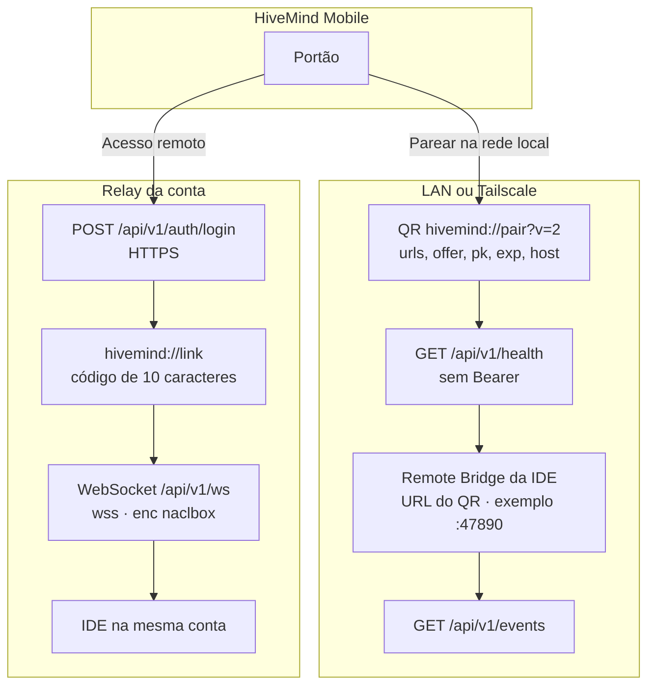

<p align="center">
  
</p>

# HiveMind Mobile

**Comande a equipe HiveMind do PC, em tempo real, pelo Android.**

[](build.gradle.kts)
[](app/build.gradle.kts)
[](app/build.gradle.kts)

Cliente nativo deste repositório (`HiveMind-App`, rótulo **HiveMind Mobile**, pacote `dev.hivemind.mobile`) para o [HiveMind](https://github.com/gilvan-Borges/hivemind). A equipe de agentes continua no computador. O celular lista os projetos abertos, conversa com as lanes, resolve aprovações, acompanha tasks e pull requests e lê o diff do workspace.

Só Android. O Gradle inclui um único módulo, `:app`. Não há alvo iOS.

`versionName` **0.2.0**, `versionCode` **3**, `minSdk` **26**, `targetSdk` **36**, `compileSdk` **36**.

## O que o app faz

- **Projetos.** Card com nome, branch, stack e equipe ativa. Badge de aprovações pendentes e de lanes rodando. Toque abre o chat; atalhos abrem Fluxo e Diffs.
- **Chat.** Seletor de lane, eventos ao vivo e modos **Auto**, **Direto**, **Planejar** e **Squad**. Cards **Aprovar** e **Recusar**. **Parar** e **Redirecionar** a lane em execução. Histórico **Sessões do projeto** com **Continuar**. Anexo pelo seletor de fotos do sistema (`PickVisualMedia`, só imagem).
- **Fluxo & Jira.** Três abas no projeto selecionado: **Minhas Tasks** (busca por chave, título ou status; **Resolver c/ Equipe**), **PRs** (**Analisar c/ Equipe**, modo `plan`) e **Auto-Review (Sem Merge)** (estado, fila, histórico e **Verificar agora**).
- **Diffs.** Arquivos com contagem de linhas adicionadas e removidas, visualizador colorido e um atalho que leva o caminho do arquivo para o chat.
- **Dois transportes.** Pareamento LAN/Tailscale pelo QR `hivemind://pair`, ou conta num relay próprio com túnel `naclbox`. Os dois chegam nas mesmas quatro abas.

Na LAN o stream é `GET /api/v1/events` (SSE, `Accept: text/event-stream`), com reconexão em 1 s, 2 s, 4 s… até 30 s. No relay o mesmo tipo de evento chega no WebSocket; o cliente para o SSE antes de abrir o túnel.

Notificações locais (canal `hivemind_events`) cobrem aprovação pendente e término de equipe, quando `POST_NOTIFICATIONS` já está concedida.

## Como o celular chega no PC



A URL ativa com `100.` no texto recebe o rótulo **Tailscale**. Qualquer outra URL do pareamento recebe **Wi-Fi**. O marcador `relay://<id da IDE>` recebe **Relay**.

Na primeira tentativa de reconexão SSE, se a rota não for relay, o app testa de novo cada URL do pareamento e troca para a primeira que responder.

## Telas

| Tela | Quando aparece | O que você faz |
|---|---|---|
| Portão | Sem pareamento salvo e sem sessão de relay | **Acesso remoto**, **Parear na rede local** ou uma conta já gravada |
| Login | Acesso remoto | URL do relay, e-mail e senha |
| Pareamento LAN | A partir do portão, ou da lista de IDEs | QR v2 da IDE ou colar o mesmo código |
| IDEs | Conta do relay aberta, sem pareamento LAN ativo | Lista online/offline, **Controlar IDE**, vincular, revogar |
| Projetos | Transporte ativo | Escolhe o workspace e vê o host e a rota |
| Chat | Aba inferior | Lane, mensagem, aprovação, anexo |
| Fluxo | Aba inferior | Tasks, PRs e Auto-Review do projeto escolhido |
| Diffs | Aba inferior | Lista e o diff de um arquivo |

A barra inferior (Projetos, Chat, Fluxo, Diffs) só entra quando existe pareamento. No modo relay, o menu **Trocar IDE** volta à lista de IDEs e mantém a conta. No modo LAN, **Desconectar do PC** apaga o DataStore e o alias `hm_lan_device`.

## Requisitos

Conferidos em `build.gradle.kts`, `app/build.gradle.kts`, `gradle.properties` e `gradle/wrapper/gradle-wrapper.properties`.

| Peça | Versão neste repo |
|---|---|
| JDK para o Android Gradle Plugin 8.9 | 21 (`gradle.properties`) |
| Bytecode do app | Java 17 (`jvmTarget` e `sourceCompatibility`) |
| Android Gradle Plugin | 8.9.2 |
| Gradle (wrapper) | 8.14.3 |
| Kotlin | 2.1.20 |
| Compose BOM | 2025.05.01 (Material 3) |
| compileSdk / targetSdk | 36 |
| minSdk | 26 (Android 8.0) |
| Heap do daemon | `-Xmx4096m` |

Também entram OkHttp 4.12.0 e `okhttp-sse`, kotlinx-serialization 1.8.1, CameraX 1.4.2, ML Kit Barcode 17.3.0, DataStore Preferences 1.1.4 e Bouncy Castle 1.78.1 (NaCl box).

O aparelho ou o emulador precisa de API 26 ou maior. A câmera é opcional no manifesto (`android.hardware.camera` com `required="false"`): sem ela, o QR não abre e dá para colar o código `hivemind://pair?v=2`.

## Build e instalação no Windows

Abra a raiz do repositório no Android Studio (JDK 21) e execute o módulo `app`.

Pela linha de comando, na raiz:

```powershell
.\gradlew.bat assembleDebug
adb install -r app\build\outputs\apk\debug\app-debug.apk
```

`app/build.gradle.kts` não redefine o diretório de saída. O `assembleDebug` deixa o APK em `app\build\outputs\apk\debug\app-debug.apk`.

O tipo `release` existe, com minify desligado e `signingConfig` de debug (APK instalável sem keystore próprio):

```powershell
.\gradlew.bat assembleRelease
```

Saída: `app\build\outputs\apk\release\app-release.apk`. Não há tarefa Gradle copiando esse arquivo para `dist\`.

Testes de unidade do módulo:

```powershell
.\gradlew.bat :app:testDebugUnitTest
```

## Pareamento

### Rede local (LAN / Tailscale)

1. Na IDE, abra o QR do App Mobile. O parser só aceita `hivemind://pair?v=2` com `urls`, `offer` (16 bytes), `pk` (32 bytes) e `exp`. `host` é opcional. Várias URLs vêm separadas por vírgula. Qualquer `token` na query é recusado.
2. No celular: **Parear na rede local**.
3. **Escanear QR Code da IDE** (CameraX + ML Kit, permissão de câmera) ou **Colar código da IDE** com o mesmo `hivemind://pair?v=2`.
4. O app chama `GET /api/v1/health` em cada URL, sem Bearer, e usa a primeira resposta com `ok: true`.
5. Gera um par X25519 e faz `POST /api/v1/pair/redeem` sem Bearer. O corpo é `appPub`, `nonce` e `ciphertext`. O plaintext da caixa é `{v:2, offer, appPub, nonce}` com nonce de 16 bytes. A resposta abre com a `pk` da oferta e traz `token` `hmlan_…`, `boxPub` e `deviceId`.
6. Grava `urls`, `host`, `active_url` e `device_id` no DataStore. Token, privada e `boxPub` ficam no alias `hm_lan_device` (AES/GCM/NoPadding). O SSE abre em seguida.

Um QR `hivemind://link` nessa tela é recusado. A mensagem pede para entrar na conta do relay e vincular a IDE por lá.

### Relay

1. **Acesso remoto.** A URL sugerida começa em `https://`. E-mail com `@` e no máximo 200 caracteres. Senha de 10 a 200 caracteres.
2. O login (`POST /api/v1/auth/login`) só segue se o access token começar com `hmr_at_` e o refresh com `hmr_rt_`.
3. HTTP fora de loopback (`localhost`, `127.0.0.1`, `::1`) é recusado, no cliente HTTP e de novo na normalização da URL. Relay público usa HTTPS. O WebSocket fica em `/api/v1/ws`: `wss://` para `https://`, `ws://` só no loopback.
4. Toque **Controlar IDE** numa IDE que já publicou a chave pública. O plano de dados cifra RPC e eventos com `enc: "naclbox"` (X25519 + XSalsa20-Poly1305, o `crypto_box` do NaCl, byte de versão `0x01`, nonce de 24 bytes).
5. Para vincular: **Ler QR / Código** ou **Gerar no App**. O URI é `hivemind://link?relay=...&code=...`. O código tem 10 caracteres do alfabeto `ABCDEFGHJKLMNPQRSTUVWXYZ23456789` e a tela mostra `ABCD-EFGH-JK`. A própria tela avisa que os dois lados precisam da mesma conta, e que o código vale 10 minutos e é de uso único. Um QR `hivemind://pair` nessa tela é recusado.
6. **Contas** troca de conta, apaga uma conta, troca a senha ou, se o papel for `owner`, cria um membro (`POST /api/v1/accounts`). Não há autocadastro no app.
7. **Sair da conta** envia `POST /api/v1/auth/logout` e remove access, refresh, expiração e IDE selecionada daquela conta. **Revogar vínculo** chama `POST /api/v1/devices/{id}/revoke`.

Cada refresh grava o par novo e descarta o refresh anterior no cofre. O comentário em `SessionSecrets.persistRotation` registra que reapresentar o refresh antigo revoga a sessão inteira.

Na abertura, `AppContainer.boot` restaura o último transporte: pareamento LAN se a preferência for `lan`; senão a IDE já escolhida no relay; senão o pareamento LAN de novo, desde que a preferência não seja `relay`.

## Estrutura

| Caminho | Função |
|---|---|
| `app/src/main/java/dev/hivemind/mobile/` | `HiveMindApp`, `MainActivity`, `AppContainer` |
| `core/api/` | Cliente HTTP do bridge, parser `hivemind://pair`, SSE, interface do túnel |
| `core/connect/` | `ConnectivityService` (`dataSync`), declarado no manifesto |
| `core/media/` | Limite de 12 MiB do quadro WebSocket e redução da imagem |
| `core/models/` | Projetos, lanes, sessões, diffs, PRs, issues, Auto-Review |
| `core/notify/` | Notificações locais |
| `core/relay/` | Login, cofre, códigos `hivemind://link`, NaCl box, WebSocket |
| `core/state/` | Estado vivo: conexão, projetos, lanes, aprovações |
| `core/store/` | `PairingStore` (DataStore do pareamento LAN) |
| `features/chat/` | Chat, aprovações, modos, anexo, sessões |
| `features/diffs/` | Lista e visualizador de diff |
| `features/flow/` | Tasks, PRs e Auto-Review |
| `features/pairing/` | QR v2 e colar o código da IDE |
| `features/projects/` | Cards e desconectar / trocar IDE |
| `features/relay/` | Portão, login, IDEs e vínculo |
| `theme/` | Tema escuro Obsidian (`#050505`, cartão `#111111`, dourado `#C6A15B`) |
| `ui/` | Cards, pills e estados vazios |

## Contrato que o cliente chama

`GET /api/v1/health` é aberto e não leva Bearer. As outras rotas diretas, inclusive o SSE, vão num quadro `{v:2, deviceId, seq, enc:"naclbox", payload}`. O plaintext é o JSON de antes mais o token. A resposta autenticada também é uma caixa, aberta com a privada do app e a `boxPub` do PC. Cada linha `data:` do SSE é uma caixa; o tipo do evento fica dentro do plaintext. Bearer em claro recebe 401 e o app pede um QR novo. Pelo relay, o mesmo caminho vai como RPC cifrado; a allowlist do túnel é esta lista, sem o SSE.

| Método | Caminho | Uso no app |
|---|---|---|
| GET | `/api/v1/health` | Prova de vida no pareamento e no host |
| GET | `/api/v1/projects` | Cards de projeto |
| GET | `/api/v1/lanes` | Estado das lanes |
| GET | `/api/v1/sessions` | Sessões salvas do workspace |
| GET | `/api/v1/session` | Mensagens de uma sessão |
| POST | `/api/v1/runs/start` | Inicia ou continua uma execução |
| POST | `/api/v1/runs/cancel` | Para a lane |
| POST | `/api/v1/runs/redirect` | Cancela e redireciona |
| POST | `/api/v1/approvals/resolve` | Aprova ou recusa |
| GET | `/api/v1/git/diffs` | Diffs do workspace |
| GET | `/api/v1/git/prs` | Pull requests |
| GET | `/api/v1/git/issues` | Tasks Jira ou GitHub |
| GET | `/api/v1/autoreview/status` | Estado do Auto-Review |
| POST | `/api/v1/autoreview/poll` | Verificação imediata |
| GET | `/api/v1/events` | SSE. Só no HTTP direto; no relay os eventos vêm no WebSocket |

Com a IDE offline, o túnel recusa o RPC, exceto `POST /api/v1/approvals/resolve`.

Plano de controle do relay, à parte do bridge: `/api/v1/auth/login`, `/api/v1/auth/refresh`, `/api/v1/auth/logout`, `/api/v1/auth/password`, `/api/v1/accounts`, `/api/v1/devices`, `/api/v1/devices/{id}/peer-key`, `/api/v1/devices/{id}/revoke`, `/api/v1/link-codes` e `/api/v1/link-codes/{code}/confirm`.

## Segurança

O token do pareamento LAN fica no aparelho, cifrado. `PairingStore` grava só `urls`, `host`, `active_url`, `device_id` e a flag antiga `background` no DataStore `hivemind_pairing`. Não grava token. A privada X25519, o token `hmlan_…` e a `boxPub` do PC ficam num blob AES/GCM/NoPadding cuja chave é o alias `hm_lan_device` do Android Keystore. **Desconectar do PC** apaga o DataStore e esse alias.

O manifesto define `android:usesCleartextTraffic="true"`. O cliente do bridge usa a URL que veio no QR ou no campo manual, e o exemplo da tela é HTTP na porta 47890. Tráfego HTTP na LAN é permitido por esse flag.

O relay é outro cofre. `KeystoreAccountVault` cifra cada segredo com AES/GCM/NoPadding e uma chave AES de 256 bits no Android Keystore (a chave não sai do keystore). Há um alias por conta (`hm_a_` + SHA-256 do id) e um índice cifrado (`hm_relay_index`) com e-mail, URL e papel, sem os tokens. No cofre da conta ficam `accessToken`, `refreshToken`, `accessExpiresAt`, o par de chaves NaCl (`publicKey` / `privateKey`) e a IDE selecionada. Trocar de conta zera a sessão em memória antes de carregar a outra. **Sair** remove os tokens; **Apagar** a conta apaga as preferências e o alias do Keystore.

`android:allowBackup="false"`. Os logs passam por `Redact`, que mascara `hmlan_`, `hmr_at_`, `hmr_rt_`, `hmr_dev_`, `Bearer` e campos JSON de senha, token e chave privada.

Dois pontos que o código deixa em aberto:

- `ConnectivityService` está no manifesto com `foregroundServiceType="dataSync"`, e `PairingStore` tem a flag `background`. Nenhuma tela chama `ConnectivityService.start` nem `setBackground`.
- O app declara `POST_NOTIFICATIONS` e só publica a notificação se a permissão já estiver concedida. Não há pedido dessa permissão nas telas.

## Repositório principal

O motor, a IDE e o Remote Bridge estão em [github.com/gilvan-Borges/hivemind](https://github.com/gilvan-Borges/hivemind). Este repositório é só o app Android.
